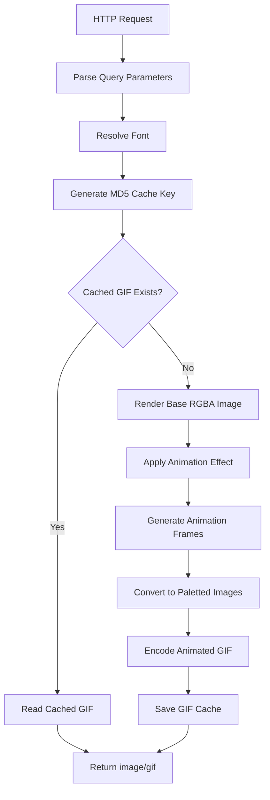

<h1 align="center">Glitch Effects API</h1>

<p align="center">
  
</p>

<p align="center">
  <b>A lightweight Go-powered animated text GIF generator.</b>
</p>

<p align="center">
  <a href="https://gor-mez8.onrender.com">Live Demo</a> ·
  <a href="https://gor-mez8.onrender.com/fonts">Fonts API</a> ·
  <a href="#api-documentation">API Documentation</a>
</p>

<p align="center">
  
  
  
  
  
</p>

---

## Overview

Glitch Effects API is a lightweight HTTP service written in Go that generates animated text GIFs with digital distortion, retro VHS, RGB separation, noise, and other visual effects.

The service uses Go's image-processing libraries to render text, apply frame-by-frame effects, and encode the result into an animated GIF.

No JavaScript, browser-side rendering, external image-processing software, or SDK is required. Simply construct a URL and receive a GIF.

## Live Service

| Resource | URL |
| --- | --- |
| Homepage | https://gor-mez8.onrender.com |
| GIF Generator (recommended) | https://gor-mez8.onrender.com/render.gif |
| GIF Generator (alias) | https://gor-mez8.onrender.com/render |
| Font List | https://gor-mez8.onrender.com/fonts |

## Features

- 17 animation effects for digital distortion and retro aesthetics.
- 10 built-in fonts embedded directly into the application.
- Custom TTF and OTF font support.
- Custom text, width, height, and font size.
- Custom HEX text and background colors.
- Transparent background support.
- Adjustable animation FPS and duration.
- Reproducible random effects using a fixed seed.
- GIF generation using Go's native image libraries.
- 256-entry GIF color palette with transparency.
- MD5-based file cache to avoid repeated rendering.
- HTTP caching headers.
- CORS support for cross-origin image requests.
- Open Graph and Twitter card metadata on the homepage, with an animated GIF preview.
- Direct integration with HTML, Markdown, GitHub README, and Discord.
- Lightweight deployment with Go.

## Effect Gallery

The API provides seventeen built-in effects.

| Effect | Description |
| --- | --- |
| `vhs` | Retro VHS distortion, scanlines, chromatic shifting, and noise |
| `static` | Random TV static noise |
| `dropout` | Horizontal signal interruptions and tracking distortions |
| `rgb` | RGB channel separation |
| `flicker` | Random brightness flickering |
| `ghost` | Motion trails and ghosting |
| `roll` | Vertical rolling distortion |
| `glitch` | Digital glitch, horizontal displacement, and noise |
| `type` | Character-by-character typing, then a blinking cursor for 2 seconds |
| `scan` | A bright band sweeping vertically across the text |
| `wave` | Sine-wave horizontal displacement of each row |
| `slice` | Text cut into horizontal strips that are shuffled and offset |
| `invert` | Colors inverted on every third frame |
| `pixelate` | Block size cycles between 2 px and 14 px |
| `bloom` | Glow overlay with slight random jitter |
| `shake` | Random screen shake |
| `zoom` | Zoom in and out pulse (1.0x to 1.15x) |

### Live Effect Previews

<p align="center">
  <b>VHS</b>
  <br/>
  
</p>

<p align="center">
  <b>STATIC</b>
  <br/>
  
</p>

<p align="center">
  <b>RGB</b>
  <br/>
  
</p>

<p align="center">
  <b>GLITCH</b>
  <br/>
  
</p>

<p align="center">
  <b>GHOST</b>
  <br/>
  
</p>

<p align="center">
  <b>TYPE</b>
  <br/>
  
</p>

<p align="center">
  <b>WAVE</b>
  <br/>
  
</p>

<p align="center">
  <b>PIXELATE</b>
  <br/>
  
</p>

The homepage shows a live preview of all 17 effects.

---

## API Documentation

### Base URL

```text
https://gor-mez8.onrender.com
```

### Endpoints

| Method | Endpoint | Description | Response |
| --- | --- | --- | --- |
| GET | `/` | Web interface and documentation | HTML |
| GET | `/render.gif` | Generate animated text GIF (recommended, works with Discord) | `image/gif` |
| GET | `/render` | Alias of `/render.gif`, identical output | `image/gif` |
| GET | `/fonts` | List available fonts | `text/plain` |

### 1. Generate GIF

```text
GET /render.gif
```

Example:

```text
https://gor-mez8.onrender.com/render.gif?text=Nam2010&effect=glitch&font=monobold&w=520&h=100&size=70&c1=ff2e88&bg=transparent&fps=15&dur=3&seed=7
```

The endpoint returns an animated GIF directly.

Successful response:

```http
HTTP/1.1 200 OK
Content-Type: image/gif
Cache-Control: public, max-age=86400
Content-Length: ...
Access-Control-Allow-Origin: *
```

If an unsupported effect is supplied, the API returns HTTP 400 with the message `unknown effect: <name>`.

### 2. List Fonts

```text
GET /fonts
```

Example:

```bash
curl https://gor-mez8.onrender.com/fonts
```

The response contains one font name per line, sorted alphabetically. It includes the built-in fonts and any valid `.ttf` or `.otf` file in the fonts directory.

### 3. Web Interface

```text
GET /
```

The homepage includes:

- Interactive gallery with a live preview of every effect.
- API documentation.
- Available font list.
- Parameter reference.
- Example generation URL.
- Open Graph and Twitter card metadata, so a link to the homepage shows an animated preview.

Any other path returns HTTP 404.

---

## Query Parameters

| Parameter | Default | Description |
| --- | --- | --- |
| `text` | `content has been deleted` | Text to render |
| `effect` | `vhs` | Animation effect (see [Effect Gallery](#effect-gallery)) |
| `font` | `monobold` | Font identifier |
| `w` | `520` | GIF width in pixels |
| `h` | `60` | GIF height in pixels |
| `size` | `max(12, h-20)` | Font size in pixels |
| `c1` | `ff2e88` | Text color in HEX |
| `bg` | `transparent` | Background color in HEX, or `transparent` |
| `fps` | `15` | Frames per second |
| `dur` | `2.5` | Animation duration in seconds. For `type`, the typing time only (see below) |
| `seed` | Random | Random generator seed |

### Parameter Constraints

| Parameter | Accepted behavior |
| --- | --- |
| `w` | Clamped between 16 and 800 |
| `h` | Clamped between 16 and 400 |
| `fps` | Clamped between 2 and 30 |
| `dur` | Maximum 10 seconds |
| Frames | Between 1 and 120 |
| `size` | Defaults to at least 12 px; supplied values are parsed as floating-point values |
| `seed` | Parsed as a signed 64-bit integer |

Frame count for every effect except `type`:

```go
n := int(float64(fps) * dur)
n = clampInt(n, 1, 120)
```

The GIF frame delay is calculated in centiseconds, with a minimum of 2:

```go
delay := 100 / fps
if delay < 2 {
    delay = 2
}
```

### The `type` Effect

The `type` effect is made of two separate phases:

1. **Typing phase.** Characters appear one by one with a cursor. Its length comes from `dur`.
2. **Cursor hold phase.** The full text stays on screen and the cursor blinks for exactly 2 seconds, then the GIF loops.

`dur` therefore sets the typing time only, and the 2 seconds of blinking are added on top:

```go
hold   := int(2.0 * float64(fps))                        // cursor hold frames
typing := clampInt(int(float64(fps)*dur), 1, 120-hold)   // typing frames
n      := typing + hold                                  // total frames
```

Because the total is still limited to 120 frames, the typing phase is capped at `120 - 2*fps` frames. At the default 15 fps that is 90 typing frames (6 seconds) plus 30 hold frames.

The cursor blinks with a half-cycle of about a third of a second (`fps/3` frames).

### Color Parameters

Colors accept 3-digit or 6-digit hexadecimal values.

Examples:

```text
c1=ff2e88
c1=00ffff
c1=ffffff
bg=000000
bg=transparent
```

The `#` prefix is also parsed, but it must be URL-encoded as `%23` when included in a URL.

Invalid color values fall back to the default pink color (`ff2e88`).

### Text Encoding

Use `+` or `%20` for spaces.

```text
text=HELLO+WORLD
```

Special characters should be URL-encoded.

---

## Available Fonts

The application embeds ten Go fonts from `golang.org/x/image/font/gofont`.

| Font | Style |
| --- | --- |
| `mono` | Monospaced |
| `monobold` | Monospaced Bold |
| `monoitalic` | Monospaced Italic |
| `monobolditalic` | Monospaced Bold Italic |
| `regular` | Regular |
| `bold` | Bold |
| `italic` | Italic |
| `bolditalic` | Bold Italic |
| `smallcaps` | Small Caps |
| `smallcapsitalic` | Small Caps Italic |

### Custom Fonts

Custom fonts are supported through `.ttf` and `.otf` files.

Default directory:

```text
fonts/
```

Example:

```text
fonts/
├── custom.ttf
├── cyberpunk.otf
└── pixel.ttf
```

Use the filename without the extension:

```text
font=cyberpunk
```

Font naming rules:

- Lowercase letters.
- Numbers.
- Underscores.
- Hyphens.
- Maximum 40 characters.

Unknown or invalid fonts automatically fall back to `monobold`.

---

## Usage Examples

### Basic Glitch

```text
https://gor-mez8.onrender.com/render.gif?text=HELLO&effect=glitch&seed=7
```

### Neon Pink

```text
https://gor-mez8.onrender.com/render.gif?text=NAM2010&effect=glitch&font=monobold&w=600&h=120&size=80&c1=ff2e88&bg=transparent&fps=15&dur=3&seed=7
```

### Retro VHS

```text
https://gor-mez8.onrender.com/render.gif?text=RETRO&effect=vhs&font=bold&w=600&h=120&size=80&c1=00ffff&bg=000000&fps=20&dur=3&seed=7
```

### RGB Distortion

```text
https://gor-mez8.onrender.com/render.gif?text=CYBER&effect=rgb&font=monobold&w=600&h=120&size=80&c1=00ffcc&bg=transparent&fps=15&dur=3&seed=7
```

### Typing Animation

```text
https://gor-mez8.onrender.com/render.gif?text=HELLO+WORLD&effect=type&font=mono&w=600&h=120&size=60&c1=ffffff&bg=000000&fps=15&dur=3&seed=7
```

### Dark Terminal Style

```text
https://gor-mez8.onrender.com/render.gif?text=SYSTEM+ONLINE&effect=static&font=mono&w=700&h=100&size=65&c1=ffffff&bg=0b0b0d&fps=15&dur=3&seed=7
```

### Wave

```text
https://gor-mez8.onrender.com/render.gif?text=WAVE&effect=wave&font=monobold&w=520&h=100&size=60&c1=00ffff&bg=transparent&fps=15&dur=3&seed=7
```

---

## Integration

### HTML

```html

```

### Markdown

```markdown

```

### Centered GitHub Banner

```html
<p align="center">
  
</p>
```

### Discord

Use the `/render.gif` URL, with the `.gif` extension. Discord sometimes treats extension-less image URLs as static images and only shows the first frame, so a link to `/render` may not animate.

```text
https://gor-mez8.onrender.com/render.gif?text=HELLO&effect=glitch&seed=7
```

Discord caches images by URL. After the server changes, add any extra parameter, for example `&v=2`, so Discord fetches a fresh GIF instead of showing the cached one. The server ignores unknown parameters.

### Python

```python
import requests

url = "https://gor-mez8.onrender.com/render.gif"

params = {
    "text": "Nam2010",
    "effect": "glitch",
    "font": "monobold",
    "w": 520,
    "h": 100,
    "size": 70,
    "c1": "ff2e88",
    "bg": "transparent",
    "fps": 15,
    "dur": 3,
    "seed": 7,
}

response = requests.get(url, params=params, timeout=60)
response.raise_for_status()

with open("glitch.gif", "wb") as f:
    f.write(response.content)

print("GIF saved successfully!")
```

### cURL

```bash
curl -L \
  "https://gor-mez8.onrender.com/render.gif?text=Nam2010&effect=glitch&seed=7" \
  -o glitch.gif
```

---

## How It Works

The rendering pipeline is implemented entirely in Go.



### Rendering Pipeline

1. Parse incoming HTTP query parameters.
2. Resolve the requested font.
3. Calculate the frame count and random seed. For `type`, the frame count is the typing frames plus the 2-second cursor hold.
4. Generate a cache key from the rendering parameters.
5. Check whether the GIF already exists in the cache.
6. Render the base text into an RGBA image.
7. Apply the selected animation effect to each frame. The `type` effect renders its own frames: the typing phase, then the cursor hold phase.
8. Convert RGBA frames into paletted images.
9. Encode all frames into an animated GIF.
10. Save the generated GIF and return it to the client.

### Image Processing

The application uses:

- `image.RGBA` for intermediate rendering.
- Alpha compositing for transparency and overlays.
- RGB channel shifting for chromatic effects.
- Random noise generation for distortion.
- Horizontal band displacement for signal interruptions.
- Scanlines for retro display effects.
- Sine-wave row displacement, strip shuffling, pixel blocks, brightness scaling, and zoom resampling for the newer effects.
- `image.Paletted` for GIF conversion.
- `image/gif` for animated GIF encoding.

### GIF Palette

The encoder constructs a 256-entry color palette.

- Palette index 0 is reserved for transparency.
- The remaining entries are generated from a six-level RGB channel mapping.
- Pixels with alpha below 32 are converted to transparent pixels.
- Each frame is disposed to the background, so frames do not stack on top of each other.

GIF is an indexed-color format, so the output is not a lossless representation of the original RGBA frames.

---

## Caching System

The application uses file-based caching.

### Cache Key

The cache key is calculated using MD5:

```go
h := md5.Sum([]byte(s))
```

The key incorporates:

- Text content.
- Effect.
- Resolved font.
- Width and height.
- Text and background colors.
- Font size.
- FPS.
- Frame count.
- Seed.

### Cache Directory

Default:

```text
cache/
```

Cached files are stored as:

```text
cache/
├── <md5>.gif
├── <md5>.gif
└── ...
```

### Seed Behavior

Without a `seed` parameter, the application generates a random seed for each request, so every request creates a new GIF and a new cache file.

With a fixed seed:

```text
seed=7
```

The random generator starts from the same seed, so the same rendering parameters reproduce the same animation. This also lets the cache reuse the same GIF file.

> Recommendation: always specify a fixed seed when embedding GIFs into GitHub README files, Discord messages, or websites.

### HTTP Cache

Successful GIF responses include:

```http
Cache-Control: public, max-age=86400
Content-Type: image/gif
Access-Control-Allow-Origin: *
```

The HTTP cache lifetime is 24 hours.

---

## Installation

### Requirements

- Go 1.20 or newer.
- Git.
- Internet access for downloading Go dependencies.

### Clone Repository

```bash
git clone https://github.com/TGFN/goR.git
cd goR
```

### Install Dependencies

```bash
go mod tidy
```

The application uses:

```text
golang.org/x/image
```

### Run

```bash
go run .
```

Default address:

```text
http://localhost:8080
```

### Build

```bash
go build -trimpath -ldflags="-s -w" -o glitch-api .
```

Run:

```bash
./glitch-api
```

### Environment Variables

The application supports three environment variables.

| Variable | Default | Description |
| --- | --- | --- |
| `PORT` | `8080` | HTTP server port |
| `CACHE_DIR` | `cache` | GIF cache directory |
| `FONTS_DIR` | `fonts` | Custom font directory |

Example:

```bash
export PORT=8080
export CACHE_DIR=cache
export FONTS_DIR=fonts

go run .
```

One-line configuration:

```bash
PORT=8080 CACHE_DIR=cache FONTS_DIR=fonts go run .
```

The application automatically creates the cache and font directories when starting.

> The homepage and its preview images use the public base URL `https://gor-mez8.onrender.com`, which is set by the `publicBase` constant in `main.go`. Change it if you deploy under a different domain.

---

## Deployment on Render

The application can be deployed as a Go Web Service.

### Build Command

```bash
go build -trimpath -ldflags="-s -w" -o app .
```

### Start Command

```bash
./app
```

### Environment Variables

```text
PORT=10000
CACHE_DIR=cache
FONTS_DIR=fonts
```

Render provides the service port through its environment. The application listens on `:$PORT`.

### Persistent Storage

The GIF cache is stored on the local filesystem.

If the deployment environment uses an ephemeral filesystem, cached files may disappear when the instance restarts or is redeployed.

For persistent cache storage, configure a persistent disk and point `CACHE_DIR` to its mounted path.

Custom fonts should also be included in the deployment or stored on persistent storage if they need to survive deployments.

On Render's free tier, the service sleeps after about 15 minutes without traffic. The first request after that is slow, so open the URL once before embedding it on GitHub.

---

## Performance Considerations

- Fixed seeds improve cache reuse.
- Repeated requests with identical parameters avoid unnecessary rendering.
- Lower FPS reduces the number of frames.
- Smaller dimensions reduce image-processing work.
- Shorter animation duration reduces frame count.
- The first uncached request requires actual GIF generation.
- The `type` effect always adds `2 * fps` frames for the cursor hold.

The maximum image dimensions are 800 × 400 pixels, with a maximum of 120 frames per animation.

---

## Error Handling

| Condition | Behavior |
| --- | --- |
| Missing text | Uses `content has been deleted` |
| Missing effect | Uses `vhs` |
| Unknown effect | HTTP 400 (`unknown effect: <name>`) |
| Invalid font | Falls back to `monobold` |
| Invalid width | Uses default or clamps to allowed range |
| Invalid height | Uses default or clamps to allowed range |
| Invalid FPS | Uses default or clamps to allowed range |
| Invalid color | Falls back to `ff2e88` |
| GIF encoding failure | HTTP 500 |
| Unknown path | HTTP 404 |

---

## Project Structure

The core application is implemented in `main.go`.

A typical deployment layout:

```text
project/
├── main.go
├── go.mod
├── go.sum
├── fonts/
│   ├── custom.ttf
│   └── pixel.otf
└── cache/
    └── generated GIF files
```

`go.mod` and `go.sum` manage Go dependencies.

The `fonts/` directory is optional because all ten built-in fonts are embedded in the application.

The `cache/` directory is created automatically.

---

## Security and Usage Notes

- Do not expose sensitive information through generated text.
- The API currently provides unrestricted cross-origin image access.
- Avoid sending excessively large volumes of generation requests.
- Use a fixed seed to reduce unnecessary cache creation.
- The MD5 cache key is used for cache identification, not cryptographic security.
- The public deployment may experience cold starts depending on hosting conditions.

---

## Technical Stack

| Component | Technology |
| --- | --- |
| Programming language | Go |
| HTTP server | `net/http` |
| Image processing | Go `image` package |
| Intermediate image format | RGBA |
| Font rendering | `golang.org/x/image/font` |
| Built-in fonts | GoFont |
| Custom fonts | OpenType / TrueType |
| GIF encoding | `image/gif` |
| Random generation | `math/rand` |
| Cache hashing | MD5 |
| Cache storage | Local filesystem |
| Hosting | Render |

---

## License

See the repository's LICENSE file for licensing terms.

If no LICENSE file is provided, all rights remain with the respective copyright holder.

---

## Contributing

Contributions, bug reports, and feature suggestions are welcome.

Potential improvements include:

- Additional glitch effects.
- More built-in fonts.
- Better GIF color quantization.
- Improved rendering performance.
- Cache management and expiration.
- More output formats.
- Additional API options.

Please open an issue or submit a pull request through the project repository.

---

<p align="center">
  <b>Glitch Effects API</b>
</p>

<p align="center">
  Generate. Distort. Animate.
</p>

<p align="center">
  Built with Go ❤️
</p>

  
  
  
</p>---

Overview

Glitch Effects API is a lightweight HTTP service written in Go that generates animated text GIFs with digital distortion, retro VHS, RGB separation, noise, and other visual effects.

The service uses Go's image-processing libraries to render text, apply frame-by-frame effects, and encode the result into animated GIF format.

No JavaScript, browser-side rendering, external image-processing software, or SDK is required.

Simply construct a URL and receive a GIF.

Live Service

Resource| URL
Homepage| https://gor-mez8.onrender.com
GIF Generator| https://gor-mez8.onrender.com/render
Font List| https://gor-mez8.onrender.com/fonts

Features

- 9 animation effects for digital distortion and retro aesthetics.
- 10 built-in fonts embedded directly into the application.
- Custom TTF and OTF font support.
- Custom text, width, height, and font size.
- Custom HEX text and background colors.
- Transparent background support.
- Adjustable animation FPS and duration.
- Reproducible random effects using a fixed seed.
- GIF generation using Go's native image libraries.
- 256-entry GIF color palette with transparency.
- MD5-based file cache to avoid repeated rendering.
- HTTP caching headers.
- CORS support for cross-origin image requests.
- Direct integration with HTML, Markdown, and GitHub README.
- Lightweight deployment with Go.

Effect Gallery

The API provides nine built-in effects.

Effect| Description
"vhs"| Retro VHS distortion, scanlines, chromatic shifting, and noise
"static"| Random TV static noise
"dropout"| Horizontal signal interruptions and tracking distortions
"rgb"| RGB channel separation
"flicker"| Random brightness flickering
"ghost"| Motion trails and ghosting
"roll"| Vertical rolling distortion
"glitch"| Digital glitch, horizontal displacement, and noise
"type"| Animated character-by-character typing

Live Effect Previews

<p align="center">
  **VHS**
  <br/>
  
</p><p align="center">
  **STATIC**
  <br/>
  
</p><p align="center">
  **RGB**
  <br/>
  
</p><p align="center">
  **GLITCH**
  <br/>
  
</p><p align="center">
  **GHOST**
  <br/>
  
</p><p align="center">
  **TYPE**
  <br/>
  
</p>API Documentation

Base URL

https://gor-mez8.onrender.com

Endpoints

Method| Endpoint| Description| Response
GET| "/"| Web interface and documentation| HTML
GET| "/render"| Generate animated text GIF| "image/gif"
GET| "/fonts"| List available fonts| "text/plain"

1. Generate GIF

GET /render

Example:

https://gor-mez8.onrender.com/render?text=Nam2010&effect=glitch&font=monobold&w=520&h=100&size=70&c1=ff2e88&bg=transparent&fps=15&dur=3&seed=7

The endpoint returns an animated GIF directly.

Successful response:

HTTP/1.1 200 OK
Content-Type: image/gif
Cache-Control: public, max-age=86400
Content-Length: ...
Access-Control-Allow-Origin: *

If an unsupported effect is supplied, the API returns HTTP 400.

2. List Fonts

GET /fonts

Example:

curl https://gor-mez8.onrender.com/fonts

The response contains one font name per line.

3. Web Interface

GET /

The homepage includes:

- Interactive effect gallery.
- API documentation.
- Available font list.
- Parameter reference.
- Example generation URLs.

Query Parameters

Parameter| Default| Description
"text"| "content has been deleted"| Text to render
"effect"| "vhs"| Animation effect
"font"| "monobold"| Font identifier
"w"| "520"| GIF width in pixels
"h"| "60"| GIF height in pixels
"size"| "max(12, h-20)"| Font size in pixels
"c1"| "ff2e88"| Text color in HEX
"bg"| "transparent"| Background color
"fps"| "15"| Frames per second
"dur"| "2.5"| Animation duration in seconds
"seed"| Random| Random generator seed

Parameter Constraints

Parameter| Accepted behavior
"w"| Clamped between 16 and 800
"h"| Clamped between 16 and 400
"fps"| Clamped between 2 and 30
"dur"| Maximum 10 seconds
Frames| Between 1 and 120
"size"| Defaults to at least 12 px; supplied values are parsed as floating-point values
"seed"| Parsed as signed 64-bit integer

Frame count is calculated using:

n := int(float64(fps) * dur)
n = clampInt(n, 1, 120)

The GIF frame delay is calculated in centiseconds:

delay := 100 / fps

Color Parameters

Colors accept 3-digit or 6-digit hexadecimal values.

Examples:

c1=ff2e88
c1=00ffff
c1=ffffff
bg=000000
bg=transparent

The "#" prefix can also be parsed, but it should be URL-encoded as "%23" when included in a URL.

Invalid color values fall back to the default pink color.

Text Encoding

Use "+" or "%20" for spaces.

Example:

text=HELLO+WORLD

Special characters should be URL-encoded.

Available Fonts

The application embeds ten Go fonts from "golang.org/x/image/font/gofont".

Font| Style
"mono"| Monospaced
"monobold"| Monospaced Bold
"monoitalic"| Monospaced Italic
"monobolditalic"| Monospaced Bold Italic
"regular"| Regular
"bold"| Bold
"italic"| Italic
"bolditalic"| Bold Italic
"smallcaps"| Small Caps
"smallcapsitalic"| Small Caps Italic

Custom Fonts

Custom fonts are supported through ".ttf" and ".otf" files.

Default directory:

fonts/

Example:

fonts/
├── custom.ttf
├── cyberpunk.otf
└── pixel.ttf

Use the filename without the extension:

font=cyberpunk

Font naming rules:

- Lowercase letters.
- Numbers.
- Underscores.
- Hyphens.
- Maximum 40 characters.

Unknown or invalid fonts automatically fall back to "monobold".

Usage Examples

Basic Glitch

https://gor-mez8.onrender.com/render?text=HELLO&effect=glitch&seed=7

Neon Pink

https://gor-mez8.onrender.com/render?text=NAM2010&effect=glitch&font=monobold&w=600&h=120&size=80&c1=ff2e88&bg=transparent&fps=15&dur=3&seed=7

Retro VHS

https://gor-mez8.onrender.com/render?text=RETRO&effect=vhs&font=bold&w=600&h=120&size=80&c1=00ffff&bg=000000&fps=20&dur=3&seed=7

RGB Distortion

https://gor-mez8.onrender.com/render?text=CYBER&effect=rgb&font=monobold&w=600&h=120&size=80&c1=00ffcc&bg=transparent&fps=15&dur=3&seed=7

Typing Animation

https://gor-mez8.onrender.com/render?text=HELLO+WORLD&effect=type&font=mono&w=600&h=120&size=60&c1=ffffff&bg=000000&fps=15&dur=3&seed=7

Dark Terminal Style

https://gor-mez8.onrender.com/render?text=SYSTEM+ONLINE&effect=static&font=mono&w=700&h=100&size=65&c1=ffffff&bg=0b0b0d&fps=15&dur=3&seed=7

Integration

HTML


Markdown


Centered GitHub Banner

<p align="center">
  
</p>

Python

import requests

url = "https://gor-mez8.onrender.com/render"

params = {
    "text": "Nam2010",
    "effect": "glitch",
    "font": "monobold",
    "w": 520,
    "h": 100,
    "size": 70,
    "c1": "ff2e88",
    "bg": "transparent",
    "fps": 15,
    "dur": 3,
    "seed": 7,
}

response = requests.get(url, params=params, timeout=60)
response.raise_for_status()

with open("glitch.gif", "wb") as f:
    f.write(response.content)

print("GIF saved successfully!")

cURL

curl -L \
  "https://gor-mez8.onrender.com/render?text=Nam2010&effect=glitch&seed=7" \
  -o glitch.gif

How It Works

The rendering pipeline is implemented entirely in Go.

flowchart TD
    A["HTTP Request"] --> B["Parse Query Parameters"]
    B --> C["Resolve Font"]
    C --> D["Generate MD5 Cache Key"]
    D --> E{"Cached GIF Exists?"}
    E -->|Yes| F["Read Cached GIF"]
    E -->|No| G["Render Base RGBA Image"]
    G --> H["Apply Animation Effect"]
    H --> I["Generate Animation Frames"]
    I --> J["Convert to Paletted Images"]
    J --> K["Encode Animated GIF"]
    K --> L["Save GIF Cache"]
    F --> M["Return image/gif"]
    L --> M

Rendering Pipeline

1. Parse incoming HTTP query parameters.
2. Resolve the requested font.
3. Calculate the frame count and random seed.
4. Generate a cache key from rendering parameters.
5. Check whether the GIF already exists in the cache.
6. Render the base text into an RGBA image.
7. Apply the selected animation effect to each frame.
8. Convert RGBA frames into paletted images.
9. Encode all frames into an animated GIF.
10. Save the generated GIF and return it to the client.

Image Processing

The application uses:

- "image.RGBA" for intermediate rendering.
- Alpha compositing for transparency and overlays.
- RGB channel shifting for chromatic effects.
- Random noise generation for distortion.
- Horizontal band displacement for signal interruptions.
- Scanlines for retro display effects.
- "image.Paletted" for GIF conversion.
- "image/gif" for animated GIF encoding.

GIF Palette

The encoder constructs a 256-entry color palette.

- Palette index 0 is reserved for transparency.
- The remaining entries are generated from a six-level RGB channel mapping.
- Pixels with alpha below 32 are converted to transparent pixels.

GIF is an indexed-color format, so output is not a lossless representation of the original RGBA frames.

Caching System

The application uses file-based caching.

Cache Key

The cache key is calculated using MD5:

h := md5.Sum([]byte(s))

The key incorporates:

- Text content.
- Effect.
- Resolved font.
- Width and height.
- Text and background colors.
- Font size.
- FPS.
- Frame count.
- Seed.

Cache Directory

Default:

cache/

Cached files are stored as:

cache/
├── <md5>.gif
├── <md5>.gif
└── ...

Seed Behavior

Without a "seed" parameter, the application generates a random seed for each request.

With a fixed seed:

seed=7

The random generator starts from the same seed, allowing the same rendering parameters to reproduce the same animation.

This also allows the cache to reuse the same GIF file.

Recommendation: Always specify a fixed seed when embedding GIFs into GitHub README files or websites.

HTTP Cache

Successful GIF responses include:

Cache-Control: public, max-age=86400
Content-Type: image/gif
Access-Control-Allow-Origin: *

The HTTP cache lifetime is 24 hours.

Installation

Requirements

- Go 1.20 or newer.
- Git.
- Internet access for downloading Go dependencies.

Clone Repository

git clone https://github.com/USERNAME/REPOSITORY.git
cd REPOSITORY

Replace the repository URL with the actual project repository.

Install Dependencies

go mod tidy

The application uses:

golang.org/x/image

Run

go run .

Default address:

http://localhost:8080

Build

go build -trimpath -ldflags="-s -w" -o glitch-api .

Run:

./glitch-api

Environment Variables

The application supports three environment variables.

Variable| Default| Description
"PORT"| "8080"| HTTP server port
"CACHE_DIR"| "cache"| GIF cache directory
"FONTS_DIR"| "fonts"| Custom font directory

Example

export PORT=8080
export CACHE_DIR=cache
export FONTS_DIR=fonts

go run .

One-Line Configuration

PORT=8080 CACHE_DIR=cache FONTS_DIR=fonts go run .

The application automatically creates the cache and font directories when starting.

Deployment on Render

The application can be deployed as a Go Web Service.

Build Command

go build -trimpath -ldflags="-s -w" -o app .

Start Command

./app

Environment Variables

PORT=10000
CACHE_DIR=cache
FONTS_DIR=fonts

Render provides the service port through its environment. The application listens on ":$PORT".

Persistent Storage

The GIF cache is stored on the local filesystem.

If the deployment environment uses an ephemeral filesystem, cached files may disappear when the instance restarts or is redeployed.

For persistent cache storage, configure a persistent disk and point "CACHE_DIR" to its mounted path.

Custom fonts should also be included in the deployment or stored on persistent storage if they need to survive deployments.

Performance Considerations

- Fixed seeds improve cache reuse.
- Repeated requests with identical parameters avoid unnecessary rendering.
- Lower FPS reduces the number of frames.
- Smaller dimensions reduce image-processing work.
- Shorter animation duration reduces frame count.
- The first uncached request requires actual GIF generation.

The maximum image dimensions are 800 × 400 pixels, with a maximum of 120 frames per animation.

Error Handling

Condition| Behavior
Missing text| Uses "content has been deleted"
Missing effect| Uses "vhs"
Unknown effect| HTTP 400
Invalid font| Falls back to "monobold"
Invalid width| Uses default or clamps to allowed range
Invalid height| Uses default or clamps to allowed range
Invalid FPS| Uses default or clamps to allowed range
GIF encoding failure| HTTP 500

Project Structure

The core application is implemented in "main.go".

A typical deployment layout:

project/
├── main.go
├── go.mod
├── go.sum
├── fonts/
│   ├── custom.ttf
│   └── pixel.otf
└── cache/
    └── generated GIF files

"go.mod" and "go.sum" manage Go dependencies.

The "fonts/" directory is optional because all ten built-in fonts are embedded in the application.

The "cache/" directory is created automatically.

Security and Usage Notes

- Do not expose sensitive information through generated text.
- The API currently provides unrestricted cross-origin image access.
- Avoid sending excessively large volumes of generation requests.
- Use a fixed seed to reduce unnecessary cache creation.
- The MD5 cache key is used for cache identification, not cryptographic security.
- The public deployment may experience cold starts depending on hosting conditions.

Technical Stack

Component| Technology
Programming language| Go
HTTP server| "net/http"
Image processing| Go "image" package
Intermediate image format| RGBA
Font rendering| "golang.org/x/image/font"
Built-in fonts| GoFont
Custom fonts| OpenType / TrueType
GIF encoding| "image/gif"
Random generation| "math/rand"
Cache hashing| MD5
Cache storage| Local filesystem
Hosting| Render

License

See the repository's LICENSE file for licensing terms.

If no LICENSE file is provided, all rights remain with the respective copyright holder.

---

Contributing

Contributions, bug reports, and feature suggestions are welcome.

Potential improvements include:

- Additional glitch effects.
- More built-in fonts.
- Better GIF color quantization.
- Improved rendering performance.
- Cache management and expiration.
- More output formats.
- Additional API options.

Please open an issue or submit a pull request through the project repository.

---

<p align="center">
  **Glitch Effects API**
</p><p align="center">
  Generate. Distort. Animate.
</p><p align="center">
  Built with Go ❤️
</p>
